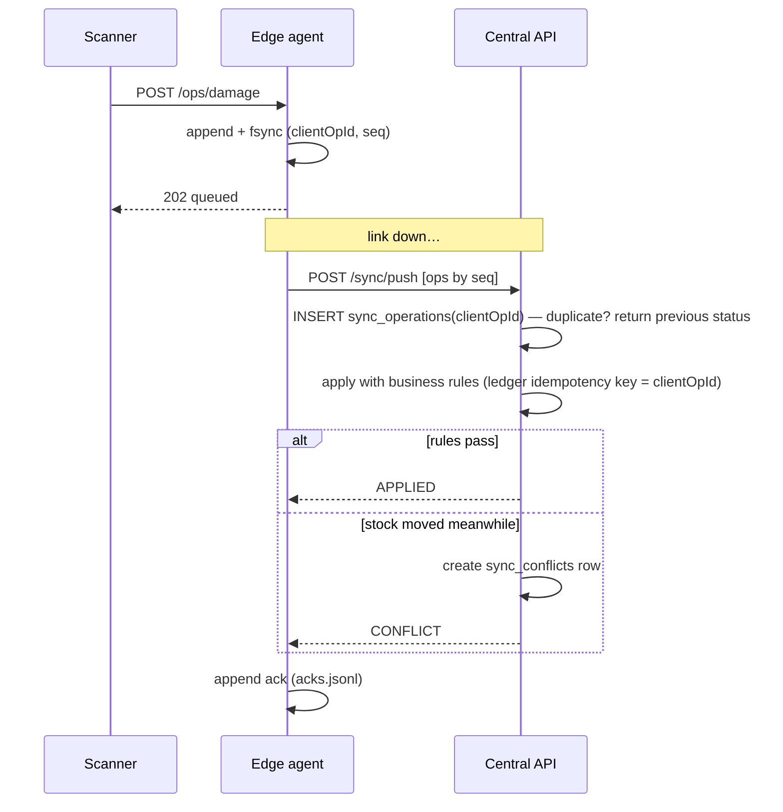

# Offline operation & synchronisation

## Data ownership

| Data | Owner | Edge copy |
| --- | --- | --- |
| Stock balances, reservations, ledger | **Central** | read-only snapshot, *advisory* while offline |
| Catalog, barcodes | Central | read-only snapshot |
| Picking tasks, counts, inbound transfers | Central | snapshot for local work |
| Operations performed in the store | **Edge journal** until acknowledged | — |

The edge never sends quantities to overwrite. It sends **intents** ("user X scanned 1 unit
for pick line Y", "batch B: 2 units damaged"). Central applies them with the same business
rules as an online request. There is no last-write-wins for stock.

## Transaction boundaries

* Edge: an operation is durable once fsync'd to `ops.jsonl`; only then does the scanner get `202`.
* Central: each operation is its own transaction (ledger movement + audit), keyed by the
  operation's client UUID (`sync_operations.client_op_id` UNIQUE, ledger idempotency key).

## What works while disconnected

Only operations the device was authorised for centrally (`allowedOps`):

| Operation | Notes |
| --- | --- |
| `PICK_SCAN` | scans for tasks that existed in the last snapshot |
| `DAMAGE_REPORT` | recorded locally; becomes a conflict if the stock was sold meanwhile |
| `COUNT_SUBMIT` | blind counts for open count sheets |
| `TRANSFER_RECEIVE` | receipts of transfers already dispatched to the store |

Customer orders are **not** accepted by a disconnected store: central stops routing to it
(its stock is not reservable centrally without the store being reachable for pick/pack status),
and global stock accuracy is not promised during isolation.

## Replay and conflicts

Conflicts appear in **Store Sync** in the console. A reviewer either **dismisses** (accepts
central state; e.g. records damage on the next count) or **retries** the original intent.
Every resolution is audited.

## Failure cases covered by tests

* restart of the agent mid-outage (journal replay, sequence continues) — `apps/edge-agent/internal/agent`
* torn final journal line after power loss — `apps/edge-agent/internal/journal`
* concurrent duplicate pushes — `apps/api/test/sync.e2e-spec.ts`
* stock sold centrally while offline → conflict, no negative stock — same suite
