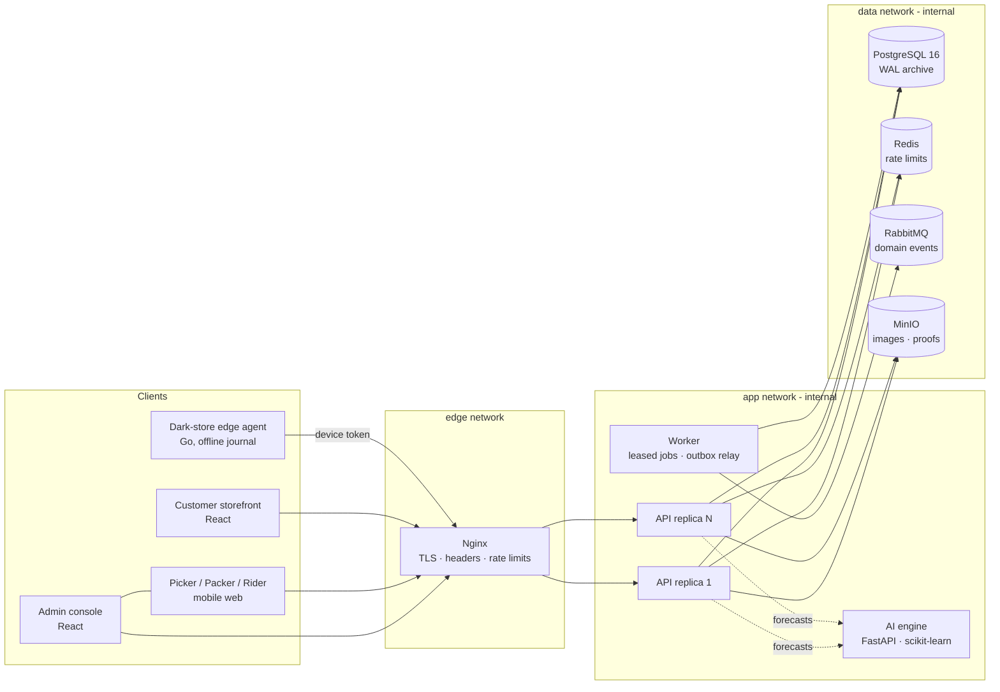
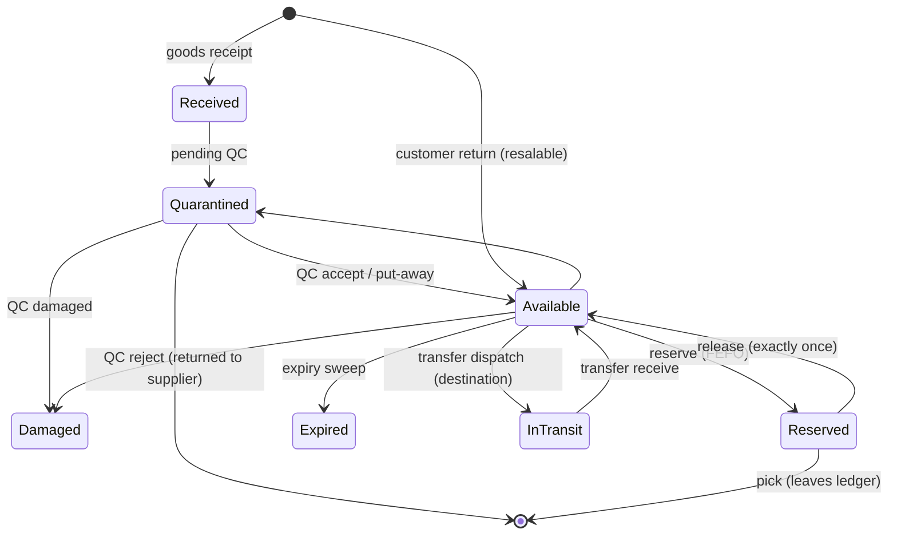

# Architecture

QuickStore is a **modular monolith**: one NestJS API process (horizontally scalable) whose
domains are separate Nest modules with their own controllers, services, DTOs and tests. Modules
talk to each other through exported services and domain events, never by reaching into each
other's tables ad hoc, so any module can be extracted into a service later.



## Domain modules (`apps/api/src/modules`)

| Module | Responsibilities |
| --- | --- |
| `auth` | Employee login, lockout, refresh-token rotation with reuse detection, password reset, sessions |
| `users` | Employees, configurable roles, permission catalogue, region / site scoping |
| `organization` | Organization, business units, regions |
| `warehouses` | Sites (central, DC, dark store), layout tree, bins, barcodes, store KPIs |
| `catalog` | Products, SKUs/variants, barcodes, categories, CSV import/export, images |
| `inventory` | **Ledger**, FEFO allocation, reservations, adjustments, QC buckets, counts, transfers |
| `procurement` | Suppliers, price history, purchase orders, approval limits, goods receipts, QC inspection |
| `customers` | Customer accounts and addresses |
| `orders` (+ `payments` in `commerce`) | Storefront, cart, store allocation, order state machine, payments, refunds, returns |
| `fulfillment` | Pick lists, waves/batches, barcode-verified picking, packing, labels |
| `delivery` | Riders, shifts, assignment, status flow, proof of delivery |
| `reports` | Live operational analytics |
| `intelligence` | Forecast runs, replenishment, anomalies (AI engine optional, labelled rule fallback) |
| `sync` | Edge devices, snapshots, exactly-once offline operation replay, conflicts |
| `governance` | Audit log, security events, settings, notifications |

Cross-cutting code lives in `common/`: the global `AuthGuard` (authentication, permission and
actor-type checks, denial auditing), `AuditService`, the standard error envelope,
`PrismaService.withRetry` (serialization-failure retry), the transactional `OutboxService`,
Redis throttler storage and label rendering.

## Inventory model

Stock is held per **(site, SKU, batch)** in `inventory_balances` with explicit buckets:

| Bucket | Meaning | In `on_hand`? |
| --- | --- | --- |
| `available` | sellable, unreserved | yes |
| `reserved` | held for an order / transfer | yes |
| `damaged` | physically present, unsellable | no |
| `quarantined` | received / returned, awaiting QC | no |
| `expired` | past expiry, awaiting disposal | no |
| `in_transit` | dispatched from another site, not yet received | no |

The database enforces `on_hand = available + reserved` and non-negative buckets with CHECK
constraints, so no code path can create an ambiguous or negative balance.

Every change goes through `LedgerService.move()`, which in **one transaction**:

1. inserts an `inventory_movements` row keyed by a unique **idempotency key**
   (`ON CONFLICT DO NOTHING` → a retried operation is a no-op), and
2. runs a single conditional `UPDATE … WHERE <from_bucket> >= qty`. If another transaction
   took the stock first, zero rows match and the whole transaction rolls back.

`inventory_movements`, `audit_logs` and `order_status_history` are append-only (trigger + revoked
privileges for the runtime role).

**FEFO**: allocation locks all candidate balance rows for a SKU in primary-key order (no
deadlocks), excludes expired / non-active batches, then fills from earliest expiry. Pickers are
sent to exactly the reserved batches; the batch's expiry is re-checked at scan time.



## Order lifecycle

```mermaid
stateDiagram-v2
  [*] --> CREATED: checkout (stock reserved in same tx)
  CREATED --> PAYMENT_PENDING: online payment
  CREATED --> INVENTORY_RESERVED: cash on delivery
  PAYMENT_PENDING --> PAYMENT_CONFIRMED: verified webhook
  PAYMENT_PENDING --> PAYMENT_FAILED
  PAYMENT_FAILED --> PAYMENT_PENDING: retry
  PAYMENT_CONFIRMED --> INVENTORY_RESERVED
  INVENTORY_RESERVED --> ACCEPTED
  ACCEPTED --> PICKING
  PICKING --> PICKED
  PICKING --> PARTIALLY_FULFILLED: short pick
  PICKED --> PACKING
  PARTIALLY_FULFILLED --> PACKING
  PACKING --> PACKED --> READY_FOR_DISPATCH --> RIDER_ASSIGNED --> OUT_FOR_DELIVERY --> DELIVERED
  OUT_FOR_DELIVERY --> READY_FOR_DISPATCH: failed attempt
  DELIVERED --> RETURN_REQUESTED --> RETURNED --> REFUND_PENDING --> REFUNDED
  CREATED --> CANCELLED
  ACCEPTED --> CANCELLED
  PICKED --> CANCELLED
  CANCELLED --> REFUND_PENDING: payment was captured
```

Transitions are validated against `ORDER_TRANSITIONS` and applied with compare-and-set on
`(status, version)`. Each one writes `order_status_history` (from, to, actor, reason, event) and an
outbox event in the same transaction.

Checkout is idempotent on `(customer_id, idempotency_key)`; concurrent retries that lose the
unique-constraint race return the winning order.

## Payments

`PaymentGateway` abstracts providers. Card data never reaches QuickStore: the client SDK talks to
the gateway; the gateway calls back with signed webhooks. Processing order: HMAC signature over the
raw body → store event under `UNIQUE(provider, provider_event_id)` (duplicates become no-ops) →
amount check → compare-and-set on payment status → order transition. If no provider is configured,
online methods are refused with `PAYMENT_NOT_CONFIGURED` (no simulated success).

## Store allocation

Candidates: active dark stores accepting orders whose service area covers the address (PIN list
or radius from real coordinates). Ranking: can fulfil every line → below concurrent-order capacity
→ lowest load ratio → shortest distance (`fulfillment.allocation.preferDistance` swaps the last two).
The reservation inside checkout is the final authority.

## Offline dark stores

See [offline-sync.md](offline-sync.md).

## Events

Order transitions emit `order.<status>` events through a **transactional outbox**
(`outbox_events`). The worker relays them to the `quickstore.events` topic exchange with publisher
confirms. Delivery is at-least-once; consumers deduplicate on the message id.

## Background jobs

`apps/api/src/worker.ts` runs leased jobs (`job_leases`), so several worker replicas never run
the same job at once: outbox relay (5 s), unpaid-order cancellation (60 s), reservation expiry (60 s),
expiry sweep (1 h), low-stock alerts (15 min).

## Deviations from the suggested layout (and why)

* **Sites**: central warehouses, DCs and dark stores share `warehouses` (dark-store attributes in
  `dark_stores`, 1:1) so inventory, transfers and movements reference one location type.
* **Layout**: zone → aisle → rack → shelf → bin is one self-referencing `storage_locations` table, so
  barcodes, capacity, state and pick sequence are handled uniformly at every level.
* **Migrations** live in `database/prisma/migrations` (Prisma's convention).
* **Packages**: shared types are not duplicated by hand. The API publishes an OpenAPI spec
  (`documentation/api/openapi.json`) that clients can generate types from.
* **Warehouse/rider mobile apps** are mobile-first routes of the admin web app (`/ops/pick`,
  `/ops/pack`, `/rider`), which avoids shipping three copies of auth and API code.
