# Database

PostgreSQL 16, managed with Prisma migrations (`database/prisma/migrations`). Schema source of truth:
[`database/prisma/schema.prisma`](../../database/prisma/schema.prisma) (~55 tables).

Conventions: UUID keys, `snake_case`, `timestamptz` (UTC), `numeric(14,2)` money, integer
quantities in the SKU's base unit, `organization_id` on every tenant-scoped row, `version`
columns for optimistic concurrency on editable aggregates.

## Core entity relationships

```mermaid
erDiagram
  organizations ||--o{ regions : has
  organizations ||--o{ warehouses : owns
  organizations ||--o{ users : employs
  regions ||--o{ warehouses : groups
  warehouses ||--o| dark_stores : "extends (1:1)"
  warehouses ||--o{ storage_locations : "zone>aisle>rack>shelf>bin"
  users }o--o{ roles : user_roles
  roles }o--o{ permissions : role_permissions
  users ||--o{ user_scopes : "region / site scope"
  users ||--o{ user_sessions : "refresh-token family"

  products ||--o{ skus : variants
  product_categories ||--o{ products : classifies
  skus ||--o{ product_barcodes : identified_by
  skus ||--o{ sku_locations : slotted_in
  storage_locations ||--o{ sku_locations : holds

  warehouses ||--o{ inventory_batches : stores
  skus ||--o{ inventory_batches : of
  inventory_batches ||--|| inventory_balances : "bucketed quantities"
  inventory_batches ||--o{ inventory_movements : "append-only ledger"
  inventory_reservations ||--o{ inventory_reservation_lines : "FEFO lines"
  stock_transfers ||--o{ stock_transfer_items : lines
  inventory_counts ||--o{ inventory_count_items : lines

  suppliers ||--o{ supplier_products : "price history"
  suppliers ||--o{ purchase_orders : receives
  purchase_orders ||--o{ purchase_order_items : lines
  purchase_orders ||--o{ goods_receipts : fulfilled_by
  goods_receipts ||--o{ goods_receipt_items : "batch + QC result"

  customers ||--o{ customer_addresses : has
  customers ||--o{ carts : has
  customers ||--o{ orders : places
  orders ||--o{ order_items : contains
  orders ||--o{ order_status_history : "append-only"
  orders ||--o{ payments : paid_by
  payments ||--o{ payment_events : "verified webhooks (unique)"
  payments ||--o{ refunds : refunded_by
  orders ||--o{ picking_tasks : picked_by
  picking_tasks ||--o{ picking_items : lines
  orders ||--o| packing_tasks : packed_by
  delivery_partners ||--o{ delivery_assignments : delivers
  delivery_assignments ||--o{ delivery_events : timeline
  delivery_assignments ||--o| proof_of_delivery : proven_by

  edge_devices ||--o{ sync_operations : pushes
  sync_operations ||--o| sync_conflicts : may_raise
```

## Integrity enforced in the database (not only in code)

| Rule | Mechanism |
| --- | --- |
| No negative stock, `on_hand = available + reserved` | CHECK constraints on `inventory_balances` |
| Ledger, audit log and order history are immutable | `BEFORE UPDATE OR DELETE` triggers + revoked privileges for the app role |
| A movement is applied once | `inventory_movements.idempotency_key` UNIQUE |
| One active reservation per order | partial unique index |
| One open picking task / delivery per order | partial unique indexes |
| Duplicate payment callbacks stored once | UNIQUE `(provider, provider_event_id)` |
| Duplicate offline operations stored once | UNIQUE `sync_operations.client_op_id` |
| PO receipts never exceed ordered quantity | CHECK + guarded `UPDATE … WHERE received_qty + n <= ordered_qty` |
| Idempotent checkout | UNIQUE `(customer_id, idempotency_key)` on `orders` |

## Concurrency policy

* **Stock**: pessimistic, row-level. FEFO allocation `SELECT … FOR UPDATE` in primary-key order;
  every bucket change is a conditional `UPDATE` guarded by the source bucket.
* **Editable records** (users, sites, products, SKUs, POs, orders): optimistic via `version`;
  a stale write returns `409 STALE_VERSION`. Nothing is silently overwritten.
* **State machines** (orders, POs, transfers, counts, reservations, deliveries): compare-and-set
  on the current status, so concurrent cancel / expire / pick produce exactly one winner.
* Serialization failures and deadlocks are retried with jittered back-off (`withRetry`).

## Partitioning

`inventory_movements`, `audit_logs`, `order_status_history`, `delivery_events` and
`sync_operations` grow without bound. At roughly 100M rows, convert them to monthly
`PARTITION BY RANGE (created_at)` tables (the append-only access pattern makes this safe) and
detach and archive partitions older than the retention period. Until then, the composite indexes
on `(organization_id, warehouse_id, sku_id, created_at)` keep lookups bounded.

## Retention

| Data | Default | Notes |
| --- | --- | --- |
| Ledger, audit, order history | indefinite (financial / audit records) | partition + archive |
| Login attempts, security events | 1 year | prune job / partition drop |
| Customer PII | `privacy.customer_retention_days` setting | anonymise inactive customers; orders keep an address snapshot |
| Backups | `BACKUP_RETENTION_DAYS` (14) + WAL | see deployment guide |
